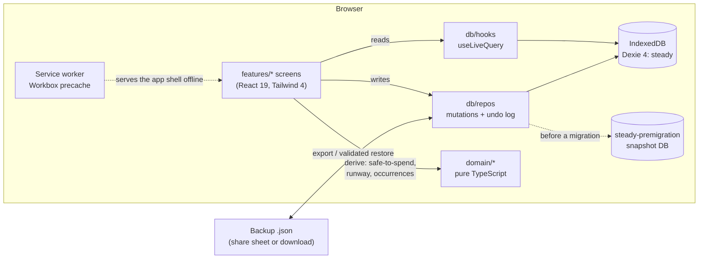

# Steady Payday Planner

**How much can I spend today, and until payday?** Steady answers that in one glance, shows
the math behind it, and never makes you feel bad about the answer.

It is an offline-first, installable web app (PWA) for budgeting from one payday to the
next. Everything stays on the device in IndexedDB: no backend, no account, no tracking.
It is built for people who find classic budgeting apps noisy or punishing, including many
people with ADHD, and it is sold as a one-time purchase with a free demo.

> Steady gives estimates from the numbers you enter. It is not financial advice.

<!-- Real screenshots land in docs/screenshots/ (see the list there). -->

| Today                                                           | Bills                                                  | Goals                                                 | Dark mode                                              |
| --------------------------------------------------------------- | ------------------------------------------------------ | ----------------------------------------------------- | ------------------------------------------------------ |
|  |  |  |  |

## The problem

Most budget templates sold on Etsy are a spreadsheet or a single HTML file. They budget by
calendar month (pay rarely arrives that way), they lose data when the browser clears
storage, they show every number at once, and they use streaks and red to "motivate". For
someone who is already stressed about money, that is a reason to stop opening the app.

Steady takes the opposite approach:

1. **Payday is the unit of time.** Weekly, every two weeks, twice a month, monthly or
   irregular pay, with a per-payday override for holidays and early pay.
2. **One number, one action.** Today shows "€23 for today" and a single next step.
3. **Nothing punishes you.** No streaks, no red, no backlog after time away.
4. **Data is sacred.** Persistent storage, a snapshot before every migration, strict
   restore validation, an undo log and a backup prompt tied to payday.

## Features compared with a typical Etsy planner

|                    | Typical Etsy budget planner   | **Steady**                                                                               |
| ------------------ | ----------------------------- | ---------------------------------------------------------------------------------------- |
| Delivery           | Spreadsheet or one HTML file  | Installable PWA (iPhone, Android, desktop)                                               |
| Offline on a phone | Rarely                        | Fully: precached app shell, data in IndexedDB                                            |
| Budget period      | Calendar month                | Your pay schedule, with per-payday overrides                                             |
| "Safe to spend"    | Manual sums                   | Derived, with "See the math"; the lines always add up                                    |
| Bills              | A static list                 | Recurring rules; pay, skip or move one date; "change from here on"                       |
| Logging            | A form per entry              | Type "12 coffee" and press Enter; one-tap repeat chips                                   |
| Mistakes           | Lost                          | Undo (persisted) and Recently deleted for 30 days                                        |
| Data loss          | Clearing the browser wipes it | `persist()`, pre-migration snapshot, validated backup and restore                        |
| Debts              | A payoff table, if any        | Snowball vs avalanche: interest saved and debt-free date                                 |
| Impulse buys       | None                          | 48-hour list with batch decisions                                                        |
| Motivation         | Streaks                       | A garden that only grows, from outcomes, not log volume                                  |
| Time away          | A wall of overdue items       | "Welcome back. Let's just update one number."                                            |
| Accessibility      | Not considered                | 44 px targets, keyboard paths, axe-checked in light and dark, large text, reduced motion |
| Trial              | None                          | A free demo on its own origin; bring your setup into the full app                        |

## Architecture



- **`src/domain`** is pure TypeScript: no React, no Dexie, no `Date.now()`. Money,
  dates, pay schedules, recurrence, reconciliation, safe-to-spend, runway, debts, the
  quick-add parser, catch-up and the next-action picker all live here, with table tests
  and fast-check properties.
- **`src/db`** holds the Dexie schema, migrations, repositories, backup/restore, the
  spreadsheet (CSV) export and the undo log. JSON is the only restore format; CSV is an
  export for Excel or Sheets, RFC 4180 quoted and guarded against formula injection. Components read through `useLiveQuery`, so IndexedDB is the only state that
  matters and every screen updates when it changes. There is no Redux and no client cache.
- **`src/features`** is one folder per screen or flow. **`src/ui`** holds the primitives
  (Button, native `<dialog>` Sheet and Dialog, MoneyInput, Segmented, Toast).
- Dependencies point inward: `domain` imports nothing from `db`, `features` or `ui`.

## Decisions

**Money in integer cents.** `€12.50` is stored as `1250`. Floats are binary fractions, so
`0.1 + 0.2` drifts. Decimals per currency come from a fixed ISO 4217 table rather than
`Intl`, because browsers ship different ICU data. Every rounding point is listed and
tested (debt interest uses `Math.round`, the per-day allowance uses `Math.floor`), and
the quick-add parser turns "12,50" into `1250` without `parseFloat`.

**Dates as `'YYYY-MM-DD'` strings.** A calendar date is not an instant. Strings compare
and sort correctly, and they carry no timezone to shift. "Today" is built from local date
parts, never `toISOString().slice(0, 10)`, which gives yesterday's date just after
midnight in CET. `useToday()` re-checks at the next local midnight and when the app
returns to the foreground, and an E2E test keeps the app open across midnight to prove it.

**Derived vs stored.** Store facts, derive everything else. A bill is one row with a
recurrence rule. Its occurrences are expanded on read, and only exceptions (paid,
skipped, moved) are stored. Pay periods, balances and safe-to-spend are computed, never
saved, so they cannot drift out of sync with their sources. Paid amounts live on the
occurrence, so editing a bill never rewrites history.

**Reconciliation.** The balance check-in is the anchor. A transaction counts if it was
created after the last check-in and isn't marked as already in the bank balance. At a
check-in, autopay bills dated on or before it are marked paid automatically, so they are
never subtracted twice. Property tests pin the rules: time passing never raises
safe-to-spend, adding a bill never raises it, and a check-in after an autopay bill
doesn't change it.

**Service worker update strategy.** `registerType: 'prompt'`: a new version installs and
waits, and a toast offers "Refresh now". Nobody loses a half-typed amount to a surprise
reload. A `controllerchange` reload only happens when no dialog is open and no field is
focused. Every tab route is imported eagerly, so an old page never asks the server for a
lazy chunk that a deploy has deleted, and a failed chunk load reloads once (with a loop
guard). Hashed assets are cached forever, `index.html` is `no-cache`.

**Unlock threat model.** The app opens with a code from the PDF. It stores only
`sha256('steady-v1:' + code)` hashes, injected at build time, never the codes. That keeps
codes out of the bundle as plain text. It is **not DRM**: anyone with DevTools can set the
flag, and that is accepted for a low-priced product with a free demo. The unlocked flag
is the single source of truth in IndexedDB. It is never exported, so a backup can't unlock
another device. A production build without hashes fails closed.

**Demo isolation.** The demo is the same code built with `--mode demo` on a separate
origin, so its storage can never touch real data. A Vite alias swaps the unlock module for
a stub (no `if (DEMO)` checks spread through the code), there is no service worker or
install prompt, and the build fails if any hash-shaped string reaches the bundle.

**No backend.** No server means no breach, no GDPR processor and no hosting bill per
user. The cost is that backups are the user's job, which is why the app makes them a
one-tap habit tied to payday.

## Run it

Needs Node 24.

```sh
npm ci
npm run dev          # http://localhost:5173, unlock code STEADY-DEMO-0000-0000-0001
npm test             # unit, property and component tests (Vitest)
npm run e2e          # Playwright: builds, previews on :4173 (and the demo on :4174)
npm run e2e:ui       # the same, in Playwright's UI mode
npm run build        # production build + PWA checks
npm run build:demo   # demo build + "no hashes in the bundle" check
```

More in [docs/DEV.md](docs/DEV.md): unlock codes, the demo build, E2E notes.

## Testing strategy

A pyramid: many fast unit and property tests, fewer component tests, a handful of
end-to-end journeys, and a manual checklist for what automation can't reach.

| Layer         | Tool                                   | What it covers                                                                                                                                                                                                                                                                                                                                                                                           |
| ------------- | -------------------------------------- | -------------------------------------------------------------------------------------------------------------------------------------------------------------------------------------------------------------------------------------------------------------------------------------------------------------------------------------------------------------------------------------------------------- |
| Domain        | Vitest + fast-check                    | Money and currency decimals, date math (leap years, month clamps, DST), all five pay schedules, recurrence splits, reconciliation and safe-to-spend properties, debt simulation, quick-add parser tables                                                                                                                                                                                                 |
| Database      | Vitest + fake-indexeddb                | Repositories, real v1 to latest migration fixtures, the pre-migration snapshot, backup round-trip, every restore rejection, the undo log                                                                                                                                                                                                                                                                 |
| Components    | Vitest + Testing Library (happy-dom)   | Setup flow, quick-add, Today math always sums, bills editor scopes, dialogs and focus                                                                                                                                                                                                                                                                                                                    |
| End to end    | Playwright (Chromium + WebKit, 390 px) | Unlock, four setup steps and a number in under 60 s; "12 coffee" lowers today by exactly €12; add a bill, mark paid, undo; backup download and restore; common categories, an @tag chip, the log filter and a formula-safe CSV export; offline after the SW is ready (Chromium); `page.clock` across local midnight; the demo opens on its two ways in (sample data, own numbers) with no lock and no SW |
| Accessibility | @axe-core/playwright                   | Zero serious or critical violations on Today, Plan, Bills, Goals, More, Settings and the "See the math" sheet, with data on screen, in light and dark                                                                                                                                                                                                                                                    |
| Bundle        | Node scripts                           | Manifest and SW checks; the demo bundle carries no hash                                                                                                                                                                                                                                                                                                                                                  |
| Manual        | A real iPhone                          | Install from the PDF, update, share a backup to Files, restore on a second device                                                                                                                                                                                                                                                                                                                        |

About 1,000 unit and component tests run in roughly 30 seconds. CI (GitHub Actions) runs
typecheck, lint, formatting, unit tests, both builds and the Chromium E2E suite on every
push and pull request.

Playwright's WebKit is not iOS Safari: it has no home-screen mode and no storage eviction,
which is why the manual checklist exists.

## Roadmap

- Help FAQ ("How this number works"), what's new, and strings behind `t()` for
  translation.
- Large-text (150%) layout pass and a performance budget (initial JS under 200 KB gzip)
  in CI.
- E2E for the update flow (open on build A, deploy B, no white screen) and EU DST days.
- Launch: legal pages, real screenshots and a screen recording, the PDF and the listing.
- Later: optional notification reminders on iOS, CSV export, more currencies' week rules.

## Stack

Vite 8, React 19, TypeScript 5 (strict), Tailwind CSS 4, Dexie 4 with
`dexie-react-hooks`, React Router, Zod (restore validation), vite-plugin-pwa (Workbox),
Vitest 5, fast-check, Testing Library, Playwright and axe-core.
